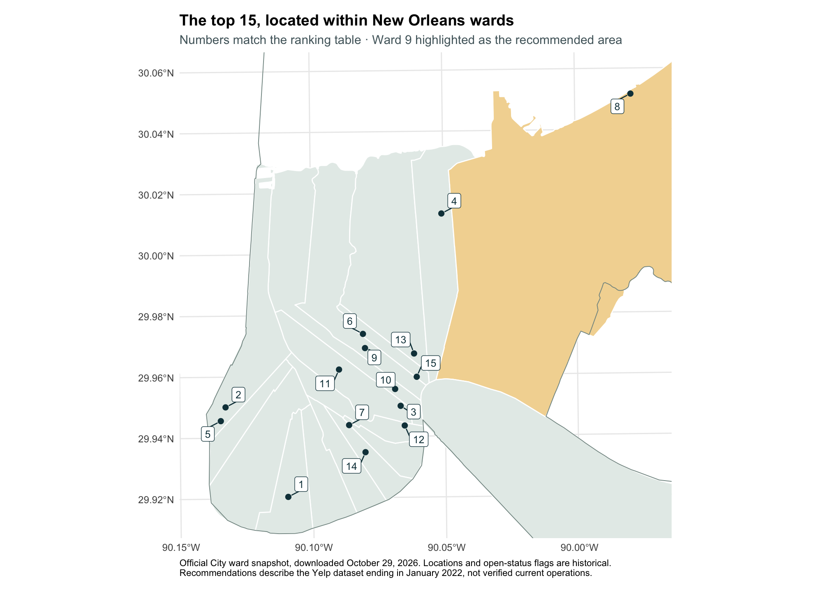

# Where to find New Orleans cooking

**[Explore the visual story →](https://brandonlee-2002.github.io/Yelp_new_orleans/yelp_new_orleans_project.html)** · [Full results](https://brandonlee-2002.github.io/Yelp_new_orleans/results.html) · [Methods & maps](https://brandonlee-2002.github.io/Yelp_new_orleans/methods.html) · [AI assistance log](https://brandonlee-2002.github.io/Yelp_new_orleans/ai-log.html)

A portfolio project by **Brandon Lee** combining large-file data preparation, reviewer-adjusted ratings, and spatial analysis in R.

> Where can someone find the top 15 restaurants for New Orleans cooking—Cajun/Creole, Seafood, Southern, or Soul Food—in New Orleans, and which geographic area is best for finding them?

## Findings

The final analysis covers **656 city-contained restaurants and 249,002 reviews**. After applying reviewer-activity and restaurant-evidence rules, **Tito’s Ceviche & Pisco, Ajun Cajun, and Restaurant August** lead the 15-place shortlist. **Ward 9** has the highest average adjusted score among wards meeting the primary area evidence minimum, but the leading ward changes under alternative rules; the data do not establish one universally best area.

- **Reviewer adjustment matters:** 12 of the adjusted top 15 also appear in the raw-rating top 15, using the same eligible pool.
- **Evidence comes first:** ranking requires a historical open flag, 50+ available reviews, and 20+ distinct eligible reviewers. Reviewers qualify with five reviews in the selected city/category pool. These rules retain 288 restaurants.
- **Geography matters:** both ZCTAs and wards contain restaurants in 17 areas. Wards offer more balanced restaurant counts; ZCTAs remain the comparison. The final top 15 span 11 wards.

**Historical snapshot:** reviews end in January 2022. “Open” refers to the dataset flag, not verified current operation. The four-label theme includes international restaurants carrying a Seafood or other selected label.



[Download the top 15](data/analysis/top_15_restaurants.csv) · [All eligible rankings](data/analysis/eligible_restaurant_rankings.csv) · [Sensitivity results](data/analysis/ranking_sensitivity.csv) · [Completion audit](PROJECT_STATUS.md)

## Portfolio format

This is **Option 2: README plus a rendered HTML report**, hosted on GitHub Pages. The visual story, results page, methods appendix, and AI log are already rendered; readers do not need to run R or Quarto. For a local copy, download the repository and open `docs/index.html` in a browser.

The visual story guides readers through the selection funnel, reviewer adjustment, standouts, map, and area uncertainty. Each chapter uses a distinct animation—selection growth, reviewer comparisons, card entrances, a map aperture, or sensitivity-tile reveals. These effects follow reduced-motion preferences and can be disabled with the Motion control; chapter links and a reading-progress indicator support navigation. The full results page contains the ranked table, definitions, sensitivity comparisons, and limitations. The methods appendix contains category counts and overlaps, data-quality checks, joins, source documentation, geographic comparisons, and diagnostic maps.

## Data and decisions

The [Yelp Open Dataset](https://business.yelp.com/data/resources/open-dataset/) business and review JSON streams were scanned in full. Exact city/state and `Restaurants` category filters retained 2,259 businesses and 476,421 reviews. The union of Cajun/Creole, Seafood, Southern, and Soul Food retained 672 businesses and 250,304 reviews. An independent city-boundary check identified 16 outside-city businesses; the main analysis uses the remaining 656 and preserves the original pool in audit files.

Geographic inputs are Census 2020 place and ZCTA polygons and a City of New Orleans ward-service snapshot downloaded October 29, 2026. [Boundary provenance, source URLs, and checksums](data/boundaries/README.md) are saved with the inputs. Two lakefront points remain outside the ward polygons; neither is in the final top 15. No nearest-area snapping is applied.

Scores subtract a reviewer's mean rating in the selected city/category pool from each review. They measure deviation from scoring habits, **not new Yelp ratings**. Both mean and median baselines and multiple evidence thresholds are compared. Ward means weight eligible restaurants equally; a ward needs ten eligible restaurants for the primary area ranking. These choices are documented analysis rules, not guarantees of statistical significance.

## Repository guide

| Location | Purpose |
|---|---|
| `docs/` | Published visual story, results page, methods appendix, and AI log |
| `yelp_new_orleans_project.qmd`, `results.qmd`, `methods.qmd`, `ai-log.qmd` | Quarto page sources |
| `initial_results.qmd`, `geographic_results.qmd`, `final_results.qmd`, `story_results.qmd` | Generated report sections |
| `R/import.R`, `R/clean.R` | Paged import, exact category filtering, saved RDS files |
| `R/analysis.R`, `R/geography.R`, `R/rankings.R` | Descriptive, geographic, and reviewer-adjusted analyses |
| `R/download_boundaries.R` | Boundary retrieval; preserves existing snapshots |
| `scripts/build_final_sections.py` | Builds final report prose and tables from exported results |
| `data/analysis/` | Derived CSV results, sensitivity comparisons, and validation records |
| `data/boundaries/` | Official boundary snapshots and metadata |
| `data/new_orleans/` | Filtered business outputs; review-level RDS files remain local |
| `data/raw/` | Local raw JSON, excluded from Git because of size |
| `figures/`, `report.css`, `report-nav.html` | Plots, page styling, and shared navigation |
| `renv.lock` | Locked R package dependencies |

## Reproduce the analysis

Use **R 4.4.1**, Python 3, and Quarto. Exact numerical reproduction requires the original Yelp extract used here (latest selected review: January 19, 2022); a different release may yield different results. Download the licensed business and review JSON files from Yelp and place them in `data/raw/` using the original filenames. They are not committed. If the filtered RDS files already exist, skip the import command below.

From R in the repository root, initialize a local package environment and restore the lockfile:

```r
install.packages("renv")
renv::init(bare = TRUE, restart = FALSE)
renv::restore(prompt = FALSE)
renv::load()
```

The lockfile was tested in a separate renv library, with package versions checked and the identical ordered top-15 IDs regenerated. R's bundled recommended packages are verified separately from the restored project packages. Native requirements for `sf`—GDAL, GEOS, PROJ, and related libraries—remain platform prerequisites when suitable binaries are unavailable. See [restore checks](data/analysis/environment_restore_check.csv) and [test result](data/analysis/environment_restore_result.txt).

Then run from the project root:

```sh
Rscript R/import.R
Rscript R/analysis.R
Rscript R/download_boundaries.R
Rscript R/geography.R
Rscript R/rankings.R
bash scripts/render.sh
```

Imports process pages of 10,000 JSON records and keep only needed columns. Filtered reviews are accumulated in memory, then saved as compressed RDS. Subsequent analysis uses the smaller files. Saved boundary snapshots are reused without downloading again. The `--no-clean` flag preserves the other HTML pages. Commit and push the rendered `docs/` files to update GitHub Pages from `main`'s `/docs` folder.

`R/lock_environment.R` is an optional maintenance script for refreshing and independently testing the environment; it does not modify the system R library. [Validation records](data/analysis/final_validation.csv) check ranking eligibility, ID uniqueness, reviewer centering, and map coordinates. The [completion audit](PROJECT_STATUS.md) links every required deliverable to evidence.

## Limits

Results are historical, category-dependent, and sensitive to evidence rules. The initial exact Yelp city-label filter can omit businesses labeled with a different city. Only 23.9% of reviews contribute to adjusted scores; activity selection changes the reviewer mix. Geographic boundary dates do not align with every review date, and some coordinates or addresses may be imprecise. The analysis does not model price, travel time, current service, causal effects, or statistically significant differences between wards.
