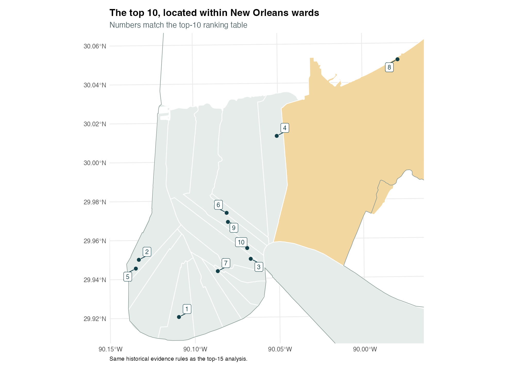
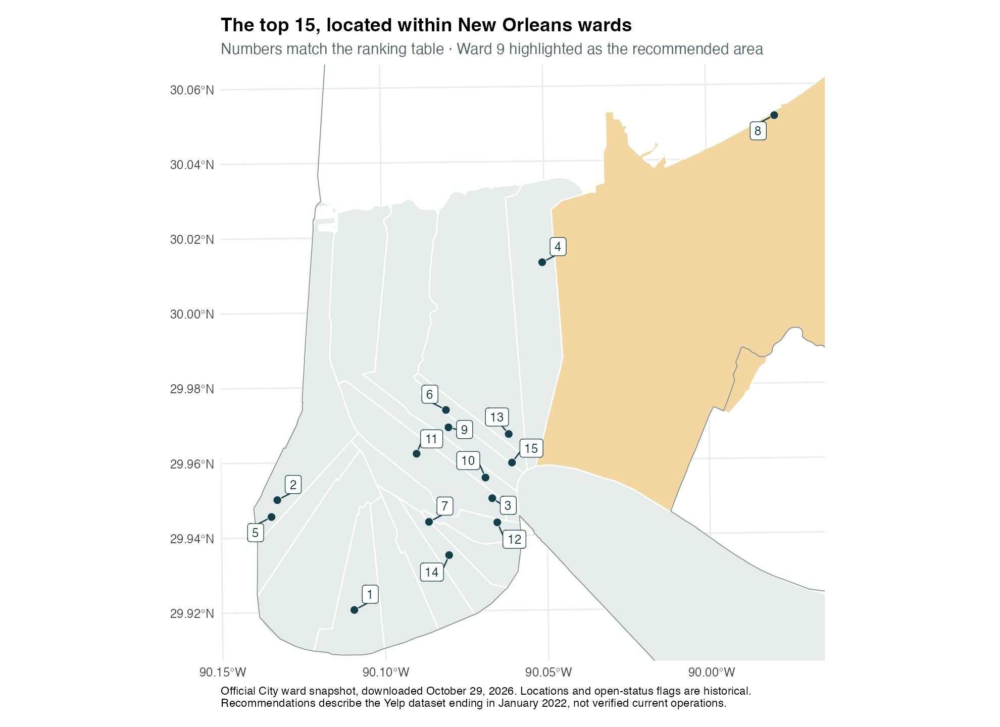
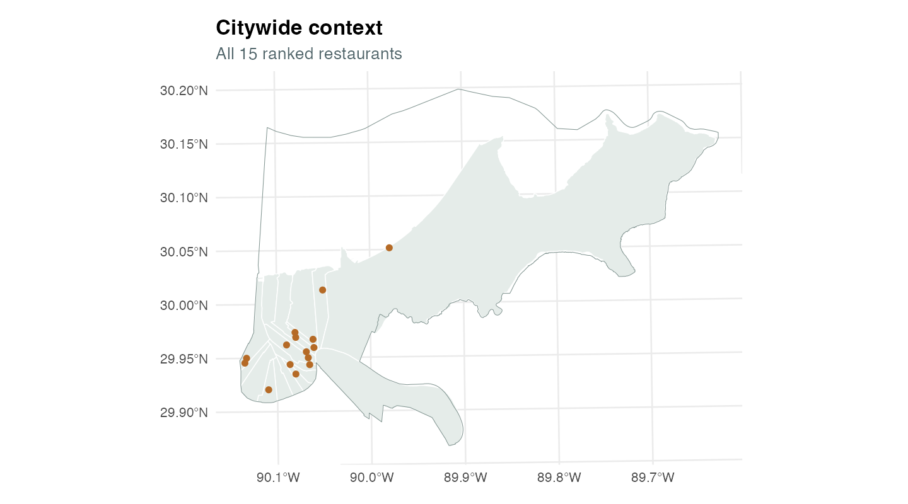
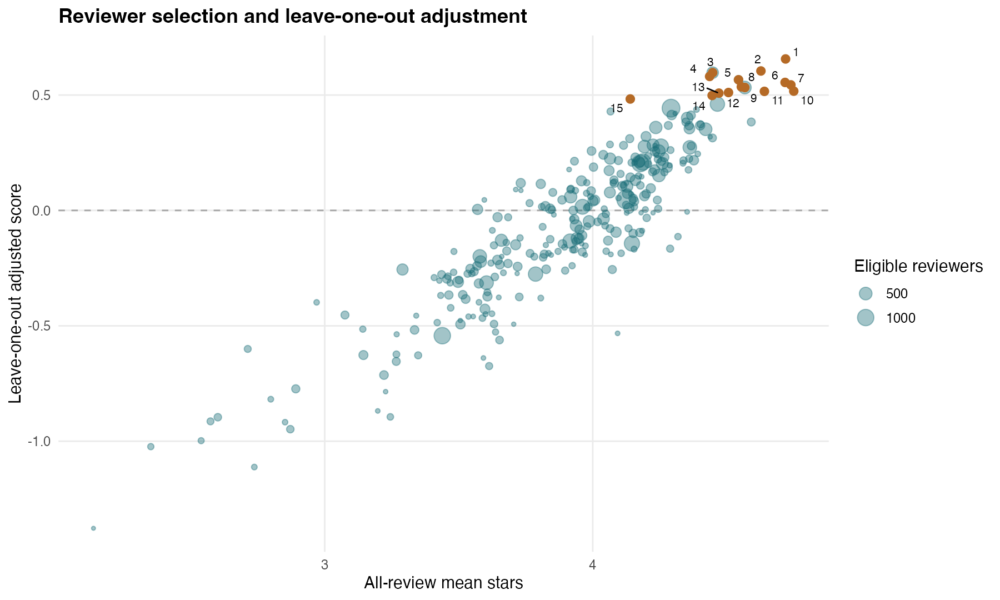
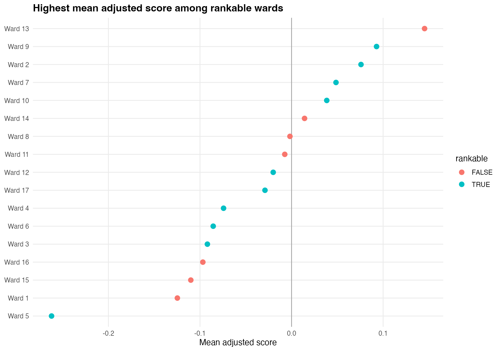

Historical Yelp data · Reviews through January 2022

656Restaurants inside New Orleans

249,002Reviews in the city/category pool

288Restaurants meeting ranking criteria

## The answer

**Tito&#x27;s Ceviche &amp; Pisco leads the restaurant ranking**, followed by Ajun Cajun and Restaurant August, after leave-one-review-out reviewer adjustment. The top 15 span **11 wards**, so the strongest individual restaurants are spread across the city.

<strong>Ward 9 has the highest mean among rankable wards under the primary rules.</strong> Its 12 eligible restaurants average <strong>+0.093 star points</strong>. The permutation test p-value is 0.270; this is not a statistically distinguished universal winner.

These findings describe a **historical dataset**, not a verified list of restaurants operating today. The primary theme includes Cajun/Creole, Seafood, Southern, or Soul Food labels; the strict-core sensitivity excludes Seafood-only businesses. It is a reproducible Yelp category grouping, not an authenticity test for New Orleans cuisine.

## The top 15

Restaurants must be inside the Census city boundary, marked open in the snapshot, have **at least 50 available reviews**, and have reviews from **at least 20 distinct eligible reviewers**. An eligible reviewer has written at least five reviews within the city/category pool. These rules retain **288 of 423 snapshot-open restaurants**.

<table class="rank-table"><thead><tr><th scope="col">Rank</th><th scope="col">Restaurant · address · theme labels</th><th scope="col">Ward</th><th scope="col">Raw stars</th><th scope="col">Adjusted</th><th scope="col">Reviews</th><th scope="col">Reviewers</th></tr></thead><tbody><tr><td>1</td><td>Tito&#x27;s Ceviche &amp; Pisco5015 Magazine St Seafood</td><td>Ward 13</td><td>4.72</td><td>+0.656</td><td>221</td><td>87</td></tr><tr><td>2</td><td>Ajun Cajun8433 Oak St Cajun/Creole; Seafood</td><td>Ward 17</td><td>4.63</td><td>+0.604</td><td>51</td><td>21</td></tr><tr><td>3</td><td>Restaurant August301 Tchoupitoulas St Cajun/Creole</td><td>Ward 3</td><td>4.45</td><td>+0.597</td><td>1,350</td><td>383</td></tr><tr><td>4</td><td>Fiorella&#x27;s the Original5325 Franklin Ave Seafood</td><td>Ward 8</td><td>4.44</td><td>+0.581</td><td>133</td><td>61</td></tr><tr><td>5</td><td>Brigtsen&#x27;s Restaurant723 Dante St Cajun/Creole; Southern</td><td>Ward 17</td><td>4.54</td><td>+0.566</td><td>353</td><td>153</td></tr><tr><td>6</td><td>Sweet Soulfood1025 N Broad St Soul Food</td><td>Ward 6</td><td>4.72</td><td>+0.555</td><td>393</td><td>62</td></tr><tr><td>7</td><td>Heard Dat Kitchen2520 Felicity St Cajun/Creole; Seafood; Soul Food</td><td>Ward 10</td><td>4.74</td><td>+0.544</td><td>579</td><td>104</td></tr><tr><td>8</td><td>Castnet Seafood10826 Hayne Blvd Seafood</td><td>Ward 9</td><td>4.55</td><td>+0.536</td><td>184</td><td>61</td></tr><tr><td>9</td><td>GW Fins808 Bienville St Seafood</td><td>Ward 4</td><td>4.57</td><td>+0.533</td><td>2,502</td><td>499</td></tr><tr><td>10</td><td>Addis Nola424 S Broad St Seafood</td><td>Ward 3</td><td>4.75</td><td>+0.517</td><td>156</td><td>52</td></tr><tr><td>11</td><td>Restaurant Rebirth857 Fulton St Cajun/Creole; Seafood; Southern</td><td>Ward 2</td><td>4.64</td><td>+0.516</td><td>534</td><td>105</td></tr><tr><td>12</td><td>Cafe Sbisa1011 Decatur St Cajun/Creole; Seafood; Southern</td><td>Ward 6</td><td>4.51</td><td>+0.511</td><td>537</td><td>93</td></tr><tr><td>13</td><td>Gabrielle Restaurant2441 Orleans Ave Cajun/Creole</td><td>Ward 5</td><td>4.47</td><td>+0.508</td><td>85</td><td>31</td></tr><tr><td>14</td><td>Budsi&#x27;s Authentic Thai1760 N Rampart St Seafood</td><td>Ward 7</td><td>4.45</td><td>+0.498</td><td>110</td><td>50</td></tr><tr><td>15</td><td>Mr John&#x27;s Steakhouse2111 St Charles Ave Seafood</td><td>Ward 10</td><td>4.14</td><td>+0.483</td><td>300</td><td>116</td></tr></tbody></table>

**Adjusted** = mean of each eligible review's stars minus that reviewer's mean stars in this category/city pool. It is a deviation in star points, **not a new Yelp rating**. Raw stars are the mean from all available reviews, displayed to two decimals. **Reviewers** counts distinct eligible reviewers, not all reviewers. Rankings use full precision; ties break by raw mean, review count, then business ID.

The 20-reviewer minimum provides more evidence than the 10-reviewer alternative while retaining 288 of that alternative's 304 restaurants. It does not guarantee statistical certainty. For example, Ajun Cajun has only 21 eligible reviewers and 51 total reviews, while Restaurant August has 383 eligible reviewers and 1,350 total reviews. Read those differences alongside their positions.

[Download the complete top-15 table](https://github.com/Brandonlee-2002/Yelp_new_orleans/blob/main/data/analysis/top_15_restaurants.csv) · [All 288 eligible restaurant rankings](https://github.com/Brandonlee-2002/Yelp_new_orleans/blob/main/data/analysis/eligible_restaurant_rankings.csv)

### Top-10 assignment view

The first ten places are also provided as an explicitly labeled top-10 deliverable. This is the same ranking and evidence pool, truncated after rank 10.

<table class=""><thead><tr><th scope="col">Rank</th><th scope="col">Restaurant</th><th scope="col">Ward</th><th scope="col">Adjusted</th><th scope="col">Reviews</th><th scope="col">Reviewers</th></tr></thead><tbody><tr><td>1</td><td>Tito&#x27;s Ceviche &amp; Pisco</td><td>Ward 13</td><td>+0.656</td><td>221</td><td>87</td></tr><tr><td>2</td><td>Ajun Cajun</td><td>Ward 17</td><td>+0.604</td><td>51</td><td>21</td></tr><tr><td>3</td><td>Restaurant August</td><td>Ward 3</td><td>+0.597</td><td>1,350</td><td>383</td></tr><tr><td>4</td><td>Fiorella&#x27;s the Original</td><td>Ward 8</td><td>+0.581</td><td>133</td><td>61</td></tr><tr><td>5</td><td>Brigtsen&#x27;s Restaurant</td><td>Ward 17</td><td>+0.566</td><td>353</td><td>153</td></tr><tr><td>6</td><td>Sweet Soulfood</td><td>Ward 6</td><td>+0.555</td><td>393</td><td>62</td></tr><tr><td>7</td><td>Heard Dat Kitchen</td><td>Ward 10</td><td>+0.544</td><td>579</td><td>104</td></tr><tr><td>8</td><td>Castnet Seafood</td><td>Ward 9</td><td>+0.536</td><td>184</td><td>61</td></tr><tr><td>9</td><td>GW Fins</td><td>Ward 4</td><td>+0.533</td><td>2,502</td><td>499</td></tr><tr><td>10</td><td>Addis Nola</td><td>Ward 3</td><td>+0.517</td><td>156</td><td>52</td></tr></tbody></table>

[Download the top-10 table](https://github.com/Brandonlee-2002/Yelp_new_orleans/blob/main/data/analysis/top_10_restaurants.csv) · [Open the top-10 map](figures/final_top_10_map.png)

### Where the top 15 are located

All 15 ranked restaurants have ward assignments. The map highlights Ward 9, the primary area-level recommendation. The region with the highest average eligible restaurant score need not contain the largest number of top-15 restaurants.

## What makes a restaurant “best”?

### Reviewers have different scoring habits

A four-star review from someone who usually awards three stars is **+1** above their baseline. The same four-star review from someone averaging 4.5 stars is **−0.5**. The primary baseline is leave-one-review-out: the target review is excluded from that reviewer's reference score. This avoids attenuating deviations for low-activity reviewers.

The primary analysis uses the **mean baseline** because it centers each reviewer's deviations at zero and retains rating differences throughout the scale. Median baselines are tested as an alternative. Reviewers are selected by activity rather than a claim that they are experts or local residents.

<table class=""><thead><tr><th scope="col">Minimum reviews per reviewer</th><th scope="col">Reviewers retained</th><th scope="col">Reviews retained</th><th scope="col">Review share</th></tr></thead><tbody><tr><td>1</td><td>138,367</td><td>249,002</td><td>100.0%</td></tr><tr><td>3</td><td>21,861</td><td>108,807</td><td>43.7%</td></tr><tr><td>5</td><td>7,066</td><td>59,584</td><td>23.9%</td></tr><tr><td>10</td><td>1,380</td><td>25,125</td><td>10.1%</td></tr></tbody></table>

The five-review threshold retains **7,066 reviewers and 59,584 reviews**. All reviewers contribute to the raw comparison; only the selected reviewers contribute to the adjusted score. This intentionally changes the reviewer mix and can exclude visitors or infrequent reviewers.

At restaurant level, each eligible review contributes equally. For area comparisons, **each eligible restaurant contributes equally**, so heavily reviewed venues do not dominate an area's score merely because they have more reviews.

### How much do the rankings change?

The selection and adjustment effects are reported separately in the sensitivity table below. The primary score uses leave-one-review-out baselines, so it is not directly comparable to the former in-sample result without consulting the legacy scenario.

Some large rank changes reflect **both reviewer selection and baseline subtraction**. The selected-reviewer raw mean below helps distinguish those mechanisms; changes cannot be attributed to normalization alone.

<table class=""><thead><tr><th scope="col">Restaurant</th><th scope="col">Raw rank</th><th scope="col">Adjusted rank</th><th scope="col">All-review stars</th><th scope="col">Selected-reviewer stars</th></tr></thead><tbody><tr><td>Today&#x27;s Cajun Seafood</td><td>112</td><td>264</td><td>4.09</td><td>3.22</td></tr><tr><td>Gallier Restaurant &amp; Oyster Bar</td><td>42</td><td>185</td><td>4.29</td><td>3.90</td></tr><tr><td>Marjie&#x27;s Grill</td><td>37</td><td>167</td><td>4.32</td><td>4.02</td></tr><tr><td>Flambo Burgers &amp; Bar</td><td>229</td><td>119</td><td>3.60</td><td>3.71</td></tr><tr><td>Jewel Of The South</td><td>33</td><td>140</td><td>4.35</td><td>4.04</td></tr></tbody></table>

### Sensitivity to the rules

<table class=""><thead><tr><th scope="col">Analysis rule</th><th scope="col">Top-15 overlap</th><th scope="col">Rank correlation†</th></tr></thead><tbody><tr><td>Selection: all-review raw to eligible-reviewer raw</td><td>12/15</td><td>0.897</td></tr><tr><td>Adjustment: eligible-reviewer raw to adjusted</td><td>15/15</td><td>0.958</td></tr><tr><td>Total: all-review raw to adjusted</td><td>15/15</td><td>0.877</td></tr><tr><td>Legacy: baseline includes own review</td><td>15/15</td><td>0.999</td></tr><tr><td>Shrinkage: empirical-Bayes adjusted score</td><td>13/15</td><td>0.998</td></tr><tr><td>Lower 90% confidence bound</td><td>13/15</td><td>0.973</td></tr><tr><td>Reviewers: 3+</td><td>11/15</td><td>0.956</td></tr><tr><td>Reviewers: 10+</td><td>13/15</td><td>0.941</td></tr><tr><td>All reviews: 25+</td><td>14/15</td><td>1.000</td></tr><tr><td>All reviews: 100+</td><td>13/15</td><td>1.000</td></tr><tr><td>Eligible reviewers: 10+</td><td>13/15</td><td>1.000</td></tr><tr><td>Eligible reviewers: 30+</td><td>14/15</td><td>1.000</td></tr><tr><td>Median baseline</td><td>13/15</td><td>0.989</td></tr><tr><td>Include closed restaurants</td><td>12/15</td><td>1.000</td></tr><tr><td>Core cuisine only (Seafood-only excluded)</td><td>8/15</td><td>1.000</td></tr></tbody></table>

† Spearman correlation on restaurants shared by the alternative and primary eligible pools. Changing evidence thresholds can change eligibility without changing the order among restaurants that remain. The seven methodological alternatives retain **10–14 of the primary top 15**. The median-baseline alternative has the lowest overlap, showing that the exact shortlist depends on the definition of adjustment.

[Full sensitivity results](https://github.com/Brandonlee-2002/Yelp_new_orleans/blob/main/data/analysis/ranking_sensitivity.csv) · [Raw, selected-reviewer, and adjusted results for all city restaurants](https://github.com/Brandonlee-2002/Yelp_new_orleans/blob/main/data/analysis/reviewer_adjusted_restaurants.csv)

## Which geographic area is best?

### Why use wards?

The same 656 city-contained locations are compared with official ZCTAs and wards. Both systems occupy 17 areas, meeting the assignment's seven-area requirement.

<table class=""><thead><tr><th scope="col">System</th><th scope="col">Populated areas</th><th scope="col">Assigned</th><th scope="col">Unmatched</th><th scope="col">Median area count</th><th scope="col">Largest area</th></tr></thead><tbody><tr><td>ZCTA</td><td>17</td><td>656</td><td>0</td><td>16</td><td>213</td></tr><tr><td>Ward</td><td>17</td><td>654</td><td>2</td><td>25</td><td>116</td></tr></tbody></table>

**Wards are the main geography** because their restaurant counts are more balanced: only one ward has fewer than ten theme restaurants, compared with five populated ZCTAs. ZCTA 70130 contains 213 restaurants, versus 116 in the largest ward. ZCTAs remain a useful postal-style comparison; they are not neighborhoods. See the [complete geographic comparison and maps](methods.html#steps-36-categories-joins-and-geography).

Two lakefront locations fall about 13–16 metres outside the nearest ward polygon despite being inside the Census city. They are documented and left unsnapped. One meets restaurant-ranking eligibility, but neither enters the top 15. The unassigned eligible restaurant contributes to the city ranking and ZCTA results, but not ward means.

### An area recommendation with an evidence minimum

To compare areas, require **at least ten restaurants that pass the final restaurant eligibility rules**, then rank wards by the equal-weight mean of their restaurant-level adjusted scores. This leaves **ten comparable wards**.

<table class=""><thead><tr><th scope="col">Ward</th><th scope="col">Eligible restaurants</th><th scope="col">Mean adjusted*</th><th scope="col">Raw stars</th><th scope="col">Total reviews</th></tr></thead><tbody><tr><td>Ward 9</td><td>12</td><td>+0.093</td><td>4.07</td><td>4,518</td></tr><tr><td>Ward 2</td><td>15</td><td>+0.076</td><td>4.11</td><td>12,592</td></tr><tr><td>Ward 7</td><td>15</td><td>+0.049</td><td>4.08</td><td>5,599</td></tr><tr><td>Ward 10</td><td>11</td><td>+0.038</td><td>4.03</td><td>3,688</td></tr><tr><td>Ward 12</td><td>16</td><td>-0.020</td><td>3.88</td><td>8,958</td></tr><tr><td>Ward 17</td><td>13</td><td>-0.029</td><td>3.88</td><td>4,815</td></tr><tr><td>Ward 4</td><td>64</td><td>-0.074</td><td>3.91</td><td>75,946</td></tr><tr><td>Ward 6</td><td>14</td><td>-0.086</td><td>3.85</td><td>8,800</td></tr><tr><td>Ward 3</td><td>49</td><td>-0.092</td><td>3.87</td><td>36,366</td></tr><tr><td>Ward 5</td><td>36</td><td>-0.262</td><td>3.64</td><td>33,944</td></tr></tbody></table>

**Ward 9 has the highest mean (+0.093; 12 eligible restaurants)** among wards meeting the primary area minimum. The result is descriptive and not statistically distinguished by the max-selection permutation test.

### Is Ward 9 a robust winner?

<table class=""><thead><tr><th scope="col">Analysis rule</th><th scope="col">Leading ward</th><th scope="col">Wards meeting area minimum</th></tr></thead><tbody><tr><td>Primary</td><td>Ward 9</td><td>10</td></tr><tr><td>Reviewers: 3+</td><td>Ward 7</td><td>10</td></tr><tr><td>Reviewers: 10+</td><td>Ward 12</td><td>7</td></tr><tr><td>All reviews: 25+</td><td>Ward 2</td><td>10</td></tr><tr><td>All reviews: 100+</td><td>Ward 2</td><td>9</td></tr><tr><td>Eligible reviewers: 10+</td><td>Ward 9</td><td>10</td></tr><tr><td>Eligible reviewers: 30+</td><td>Ward 7</td><td>9</td></tr><tr><td>Median baseline</td><td>Ward 2</td><td>10</td></tr><tr><td>Include closed restaurants</td><td>Ward 13</td><td>14</td></tr><tr><td>Core cuisine only (Seafood-only excluded)</td><td>Ward 2</td><td>7</td></tr><tr><td>Area minimum: 5+</td><td>Ward 13</td><td>15</td></tr><tr><td>Area minimum: 15+</td><td>Ward 2</td><td>6</td></tr></tbody></table>

**No single ward should be presented as universally best.** Area sensitivity and the permutation test are included to show how the highest mean changes under alternative specifications. Use the individual top-15 locations for a more specific shortlist.

[Ward and ZCTA adjusted summaries](https://github.com/Brandonlee-2002/Yelp_new_orleans/blob/main/data/analysis/adjusted_area_summary.csv) · [Area recommendation sensitivity](https://github.com/Brandonlee-2002/Yelp_new_orleans/blob/main/data/analysis/area_recommendation_sensitivity.csv)

### Bootstrap uncertainty

As a stability diagnostic, 1,000 bootstrap replicates resample eligible reviews within each restaurant while holding the eligibility pool, reviewer baselines, and geography fixed. The resulting intervals describe score instability under that design; they are not population confidence intervals. See the [rank uncertainty table](https://github.com/Brandonlee-2002/Yelp_new_orleans/blob/main/data/analysis/rank_uncertainty.csv), [ward significance table](https://github.com/Brandonlee-2002/Yelp_new_orleans/blob/main/data/analysis/ward_significance.csv), and [split-half reliability table](https://github.com/Brandonlee-2002/Yelp_new_orleans/blob/main/data/analysis/split_half_reliability.csv).

<table class=""><thead><tr><th scope="col">Rank</th><th scope="col">Restaurant</th><th scope="col">Rank 5th pct.</th><th scope="col">Median rank</th><th scope="col">Rank 95th pct.</th><th scope="col">Top-15 probability</th><th scope="col">Overlaps ranks 16–20</th></tr></thead><tbody><tr><td>1</td><td>Tito&#x27;s Ceviche &amp; Pisco</td><td>1</td><td>3</td><td>9.04999999999995</td><td>99.9%</td><td>FALSE</td></tr><tr><td>2</td><td>Ajun Cajun</td><td>1</td><td>5</td><td>24</td><td>86.2%</td><td>TRUE</td></tr><tr><td>3</td><td>Restaurant August</td><td>2</td><td>6</td><td>12</td><td>98.8%</td><td>FALSE</td></tr><tr><td>4</td><td>Fiorella&#x27;s the Original</td><td>1</td><td>7</td><td>20</td><td>88.4%</td><td>TRUE</td></tr><tr><td>5</td><td>Brigtsen&#x27;s Restaurant</td><td>2</td><td>8</td><td>18</td><td>89.7%</td><td>TRUE</td></tr><tr><td>6</td><td>Sweet Soulfood</td><td>1</td><td>8</td><td>30</td><td>76.1%</td><td>TRUE</td></tr><tr><td>7</td><td>Heard Dat Kitchen</td><td>2</td><td>9</td><td>25</td><td>79.3%</td><td>TRUE</td></tr><tr><td>8</td><td>Castnet Seafood</td><td>1</td><td>11</td><td>38</td><td>67.3%</td><td>TRUE</td></tr><tr><td>9</td><td>GW Fins</td><td>5</td><td>10</td><td>18</td><td>88.2%</td><td>TRUE</td></tr><tr><td>10</td><td>Addis Nola</td><td>4</td><td>12</td><td>26</td><td>72.1%</td><td>TRUE</td></tr><tr><td>11</td><td>Restaurant Rebirth</td><td>3</td><td>12</td><td>30</td><td>68.5%</td><td>TRUE</td></tr><tr><td>12</td><td>Cafe Sbisa</td><td>3</td><td>12</td><td>32</td><td>66.0%</td><td>TRUE</td></tr><tr><td>13</td><td>Gabrielle Restaurant</td><td>1</td><td>12</td><td>47</td><td>61.7%</td><td>TRUE</td></tr><tr><td>14</td><td>Budsi&#x27;s Authentic Thai</td><td>2</td><td>14</td><td>46</td><td>56.3%</td><td>TRUE</td></tr><tr><td>15</td><td>Mr John&#x27;s Steakhouse</td><td>5</td><td>15</td><td>36</td><td>53.6%</td><td>TRUE</td></tr></tbody></table>

## Data, scope, and limitations

- **Scope:** initial exact city-label filtering found 672 theme restaurants. Sixteen map to other Census places; the main city-contained analysis uses 656 restaurants and 249,002 reviews. Their original records remain in an audit. Businesses labeled with another Yelp city were not recovered by this initial filter.
- **Historical data:** selected reviews run from March 2005 to January 2022. Snapshot-open flags do not establish current operation, and pooling years can hide changes in quality or ownership.
- **Completeness:** retained columns have no NA values; seven initial restaurant records have blank street addresses. Coordinates remain available. Missingness checks do not establish accuracy.
- **Reviewer and category selection:** only 23.9% of reviews contribute to adjusted scores. Category labels overlap and are not evidence of a uniquely local menu. Scores remain subject to selection bias and unequal reviewer coverage.
- **Boundaries and precision:** place/ZCTA polygons are from Census 2020; wards are a City service snapshot downloaded in 2026 with an unspecified historical effective date. Small shoreline gaps and two unmatched ward points are retained transparently.
- **Reliability:** evidence thresholds and sensitivity comparisons improve transparency but do not establish a population-best restaurant or statistically significant ward differences. Prices, travel time, accessibility, recency, and service preferences were not modeled.
- **Ethics and use:** Yelp categories are imperfect cuisine proxies; reviewer activity is not expertise or local residency; historical open flags are not current availability; and the results should support exploration rather than declare objective restaurant quality. Data use and redistribution should follow the source dataset's terms.

## Reproduce and inspect

The [methods appendix](methods.html) documents category counts and co-occurrences, large-file handling, review joins, cleaning decisions, geography selection, and full coverage maps. The [AI assistance log](ai-log.html) records prompts, corrections, and AI-supported decisions.

R code, exported tables, saved boundary snapshots, and a dependency lockfile are in the [GitHub repository](https://github.com/Brandonlee-2002/Yelp_new_orleans). Follow the README's commands to rebuild the results and HTML. The lockfile restore is checked separately from the raw-data download, and raw JSON/review-level RDS files are excluded from Git. [Review the completion audit](https://github.com/Brandonlee-2002/Yelp_new_orleans/blob/main/PROJECT_STATUS.md).

Brandon Lee · Yelp New Orleans Restaurant Analysis · Historical dataset, 2005–2022 · Updated October 29, 2026

