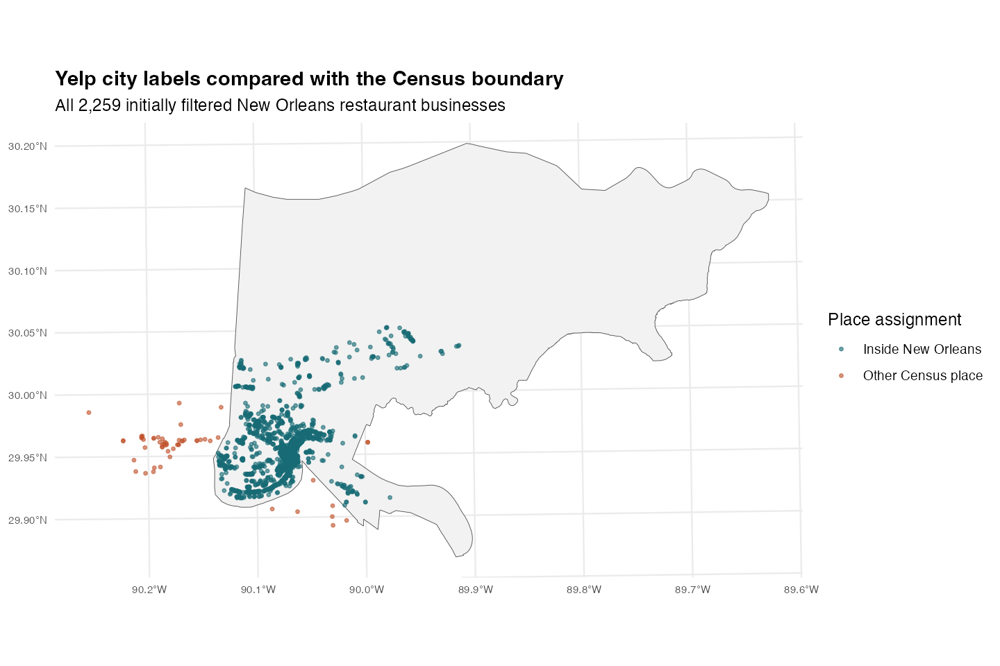
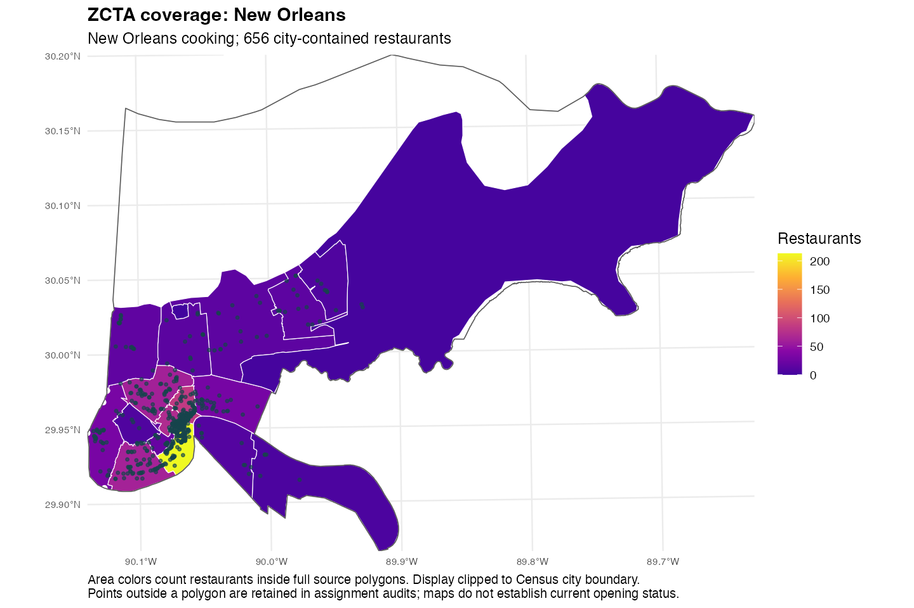
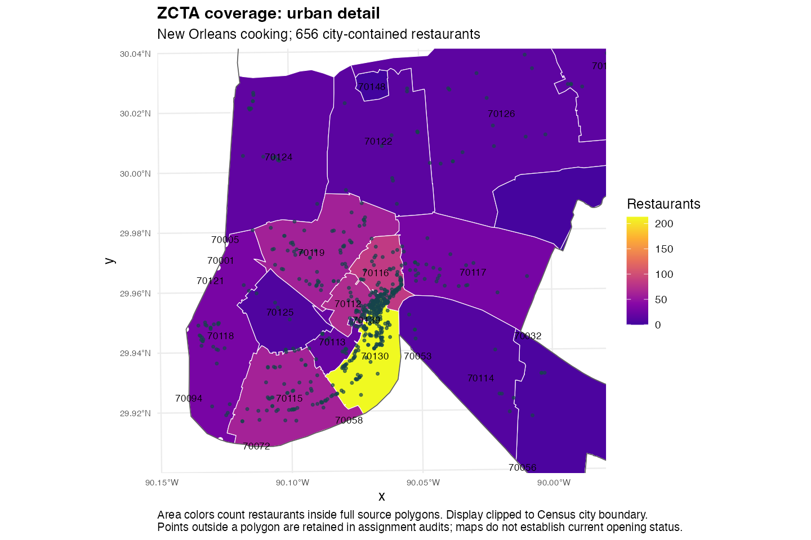
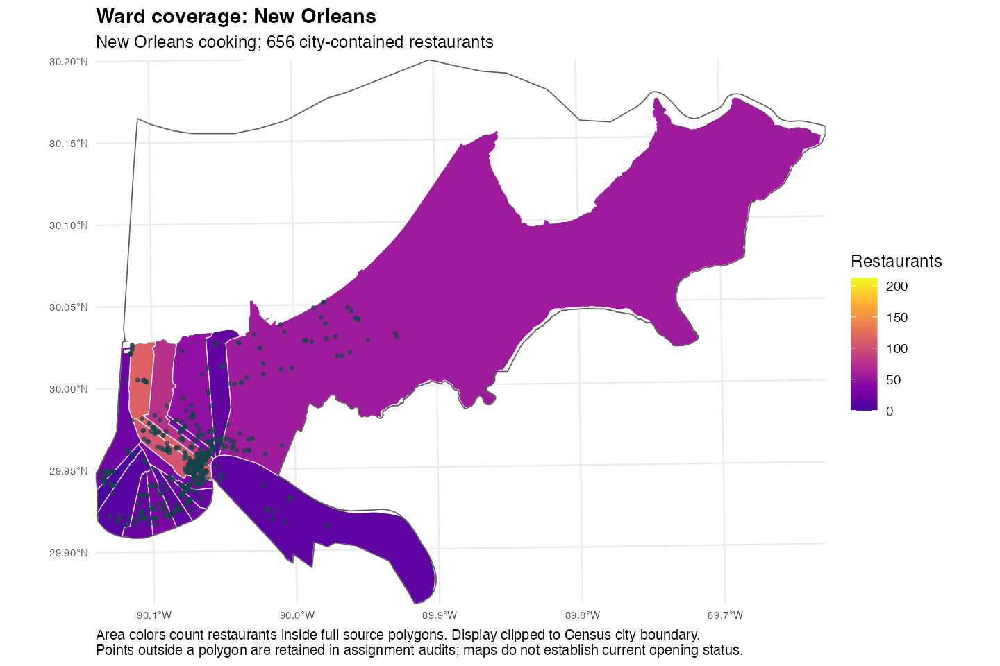
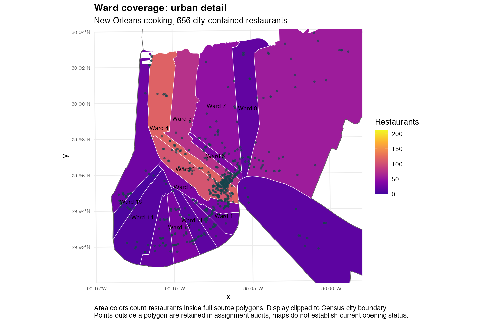
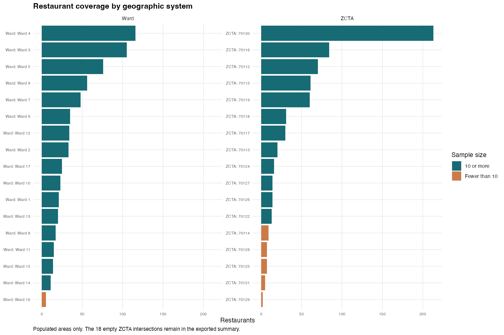
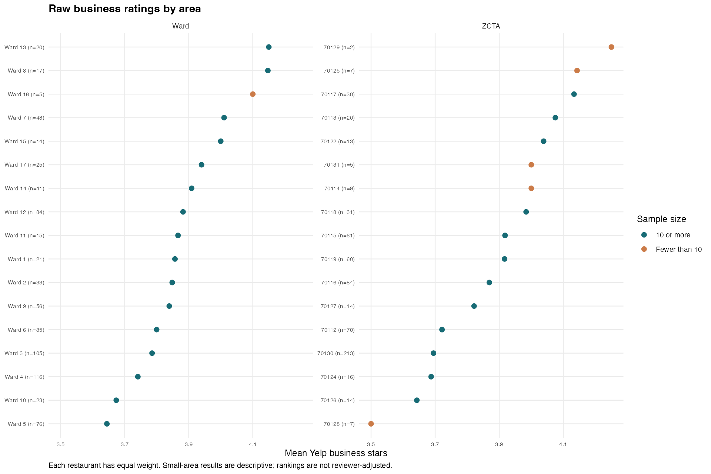

## Steps 3–6: categories, joins, and geography

### Step 3: category evidence

The selected New Orleans cooking theme connects Cajun/Creole, seafood, Southern, and soul-food traditions. A restaurant qualifies by matching at least one selected category, rather than all four. The labels are an operational definition, not proof that every menu is uniquely local. Category memberships overlap.

The initial city-label subset contains 672 restaurants. After the explicit city-boundary check below, 656 restaurants remain in the geographic comparison:

::: {.report-table tabindex="0" role="region" aria-label="Scrollable data table"}

| Category | Initial subset | Inside city |
| --- | --- | --- |
| Cajun/Creole | 401 | 398 |
| Seafood | 331 | 320 |
| Southern | 155 | 150 |
| Soul Food | 70 | 69 |

:::

Co-occurrence among the 656 city-contained restaurants supports analyzing the labels together:

::: {.report-table tabindex="0" role="region" aria-label="Scrollable data table"}

| Category 1 | Category 2 | Restaurants |
| --- | --- | --- |
| Cajun/Creole | Seafood | 155 |
| Cajun/Creole | Southern | 71 |
| Cajun/Creole | Soul Food | 30 |
| Seafood | Southern | 43 |
| Seafood | Soul Food | 19 |
| Southern | Soul Food | 18 |

:::

The selected group occupies **17 ZCTAs and all 17 wards**. Both systems exceed the requirement of 10 restaurants across seven geographic areas. Category-by-area counts, average ratings, and review volumes are exported in [category_by_area.csv](https://github.com/Brandonlee-2002/Yelp_new_orleans/blob/main/data/analysis/category_by_area.csv).

### Step 4: businesses joined to reviews

Reviews were filtered before joining. An explicit many-to-one join on business_id attaches business names and categories to every selected review, preserving review IDs and the row count. The joined review-level RDS is saved locally as data/new_orleans/reviews_cooking_joined.rds; the smaller audit is committed.

::: {.report-table tabindex="0" role="region" aria-label="Scrollable data table"}

| Check | Count |
| --- | --- |
| Selected restaurants | 672 |
| Reviews before join | 250,304 |
| Reviews after join | 250,304 |
| Unmatched review businesses | 0 |
| Duplicate review IDs after join | 0 |

:::

The later city-only geographic subset contains **249,002 reviews** for 656 restaurants. The original 250,304-review subset is preserved; the new city-only RDS files are separate.

### Step 5: official city-boundary check

All 2,259 initial New Orleans restaurant locations were spatially joined to 2020 Census Louisiana place polygons using sf::st_join and st_within. The join assigns 2,202 to New Orleans and 57 to other Census places; no locations lack a place match. Among the selected theme, 656 are in New Orleans and 16 are assigned to nearby places such as Jefferson, Harahan, and Elmwood.

For the main geographic comparison, use the official city-contained subset so ZCTAs and wards describe the same city. This is an explicit analytical scope choice, not deletion of the original records. City-label mismatches may reflect postal labeling, geocoding, mobile businesses, or boundary differences; their specific causes are not established. The export includes place names and distances to the city for review. Le Petit Bistro, for example, has a blank address and coordinates in Kenner despite a New Orleans postal label and requires further checking.

[All place assignments](https://github.com/Brandonlee-2002/Yelp_new_orleans/blob/main/data/analysis/restaurant_place_assignments.csv) · [Selected restaurants outside the city](https://github.com/Brandonlee-2002/Yelp_new_orleans/blob/main/data/analysis/cooking_outside_city.csv)

### Step 6: ZCTAs compared with wards

Restaurant coordinates are transformed from longitude/latitude (EPSG:4326) to NAD83 / Louisiana South in metres (EPSG:26982). Polygon validity is repaired before spatial joins. The same 656 city-contained locations are joined to each system with st_within. No nearest-area assignment or snapping is applied. The joins are checked for duplicated businesses and boundary-touching points.

::: {.report-table tabindex="0" role="region" aria-label="Scrollable data table"}

| System | Populated areas | Assigned | Unmatched | Min count* | Max count |
| --- | --- | --- | --- | --- | --- |
| ZCTA | 17 | 656 | 0 | 2 | 213 |
| Ward | 17 | 654 | 2 | 5 | 116 |

:::

*Minimum among populated areas. Of 35 ZCTA polygons intersecting the city, 18 contain no selected city restaurants and five populated ZCTAs contain fewer than 10. All 17 wards contain selected restaurants, and only Ward 16 has fewer than 10 (five). Empty and small areas are retained in the exported summaries. Empty areas have no rating, not a rating of zero.

The two unmatched ward locations are Felix's Restaurant & Oyster Bar and Brisbi's Lakefront Restaurant & Bar, both at 7400 Lakeshore Drive. They fall inside the Census city but approximately 16.3 and 13.4 metres outside the nearest Ward 4 polygon. These shoreline discrepancies could reflect coordinate or boundary precision; they are not corrected without further evidence. Both receive ZCTA 70124. They remain in the city dataset and are omitted only from ward-level aggregates.

[Complete comparison](https://github.com/Brandonlee-2002/Yelp_new_orleans/blob/main/data/analysis/geography_comparison.csv) · [Unmatched ward locations](https://github.com/Brandonlee-2002/Yelp_new_orleans/blob/main/data/analysis/ward_unmatched.csv)

The full-city maps preserve the geographic context; the urban-detail panels make the dense restaurant cluster readable. Colors describe counts in the full source areas, using only city-contained restaurants. Displayed boundaries are clipped to the Census city. ZCTAs are Census approximations of postal service areas, not neighborhoods; wards are the City's numbered divisions, not neighborhood labels.

#### Main geographic choice: wards

Use **wards** for the main area comparison and keep ZCTAs as the sensitivity comparison. Wards divide this restaurant pool more evenly: the median populated-area count is 25 versus 16 for ZCTAs, the largest ward contains 116 restaurants versus 213 in the largest ZCTA, and only one ward has fewer than 10 restaurants versus five populated ZCTAs. Both systems offer 17 populated areas. Wards therefore reduce the number of very small samples while retaining city-specific numbered areas that can be shown clearly on maps. This choice follows coverage and sample-size evidence, not which system yields a higher rating.

The tradeoffs are the two unmatched lakefront points, the need to explain ward numbers to visitors, and broad wards that can hide variation within an area. Ward 16's five restaurants are too few for a strong area-level recommendation; its rating remains descriptive. ZCTAs offer familiar postal-style identifiers and complete assignment of the city subset, so both sets of results remain available. Restaurant counts measure selection, not density per square kilometre or travel convenience.

#### Area summaries

Means below give each restaurant equal weight, not each review. Review totals indicate evidence volume but do not establish independence or uncertainty. These are historical raw-rating summaries; the final reviewer-adjusted comparison is presented in the main report.

**Wards**

::: {.report-table tabindex="0" role="region" aria-label="Scrollable data table"}

| Area | Restaurants | Marked open | Mean stars | Reviews |
| --- | --- | --- | --- | --- |
| Ward 4 | 116 | 74 | 3.74 | 84,332 |
| Ward 3 | 105 | 69 | 3.79 | 41,454 |
| Ward 5 | 76 | 47 | 3.64 | 39,927 |
| Ward 9 | 56 | 42 | 3.84 | 6,248 |
| Ward 7 | 48 | 34 | 4.01 | 7,191 |
| Ward 6 | 35 | 21 | 3.80 | 10,634 |
| Ward 12 | 34 | 25 | 3.88 | 9,798 |
| Ward 2 | 33 | 17 | 3.85 | 14,007 |
| Ward 17 | 25 | 14 | 3.94 | 6,338 |
| Ward 10 | 23 | 13 | 3.67 | 5,209 |
| Ward 1 | 21 | 13 | 3.86 | 3,904 |
| Ward 13 | 20 | 12 | 4.15 | 4,412 |
| Ward 8 | 17 | 10 | 4.15 | 3,606 |
| Ward 11 | 15 | 11 | 3.87 | 8,925 |
| Ward 15 | 14 | 10 | 4.00 | 413 |
| Ward 14 | 11 | 7 | 3.91 | 1,324 |
| Ward 16 | 5 | 3 | 4.10 | 832 |

:::

**ZCTAs**

::: {.report-table tabindex="0" role="region" aria-label="Scrollable data table"}

| Area | Restaurants | Marked open | Mean stars | Reviews |
| --- | --- | --- | --- | --- |
| 70130 | 213 | 130 | 3.69 | 133,630 |
| 70116 | 84 | 47 | 3.87 | 28,730 |
| 70112 | 70 | 45 | 3.72 | 26,367 |
| 70115 | 61 | 42 | 3.92 | 17,071 |
| 70119 | 60 | 44 | 3.92 | 18,065 |
| 70118 | 31 | 18 | 3.98 | 7,280 |
| 70117 | 30 | 18 | 4.13 | 7,651 |
| 70113 | 20 | 15 | 4.08 | 4,253 |
| 70124 | 16 | 11 | 3.69 | 2,553 |
| 70126 | 14 | 11 | 3.64 | 450 |
| 70127 | 14 | 10 | 3.82 | 705 |
| 70122 | 13 | 10 | 4.04 | 968 |
| 70114 | 9 | 6 | 4.00 | 281 |
| 70128 | 7 | 7 | 3.50 | 398 |
| 70125 | 7 | 3 | 4.14 | 407 |
| 70131 | 5 | 4 | 4.00 | 132 |
| 70129 | 2 | 2 | 4.25 | 61 |

:::

Ward 4 has the most qualifying restaurants (116); Ward 13 has the highest mean business rating among wards with at least 10 restaurants (4.15, n=20), narrowly ahead of Ward 8 (4.147, n=17). This is not enough to declare a final best area. ZCTA 70130 has the largest selection (213), while 70117 leads populated ZCTAs with at least 10 restaurants in raw mean stars (4.13, n=30). The main report checks these raw patterns against reviewer adjustment and final eligibility rules.

#### Boundary sources and time limitations

Census boundaries: [2020 TIGER/Line place files](https://www.census.gov/geographies/mapping-files/time-series/geo/tiger-line-file.html) and [2020 cartographic ZCTA boundaries](https://www.census.gov/geographies/mapping-files/time-series/geo/cartographic-boundary.html), obtained with tigris. Wards: [City of New Orleans Enterprise GIS, Administrative Layers, Wards layer 3](https://maps.nola.gov/server/rest/services/Administrative/Administrative_Layers/MapServer/3), downloaded October 29, 2026. The ward service does not state a historical effective date; it is a saved current-service snapshot, not verified 2020 ward geometry. Yelp reviews span 2005–2022, so neither boundary set proves which area applied at every review date. Saved boundaries, source metadata, and checksums support reproduction; no demographic or causal claims are made.
