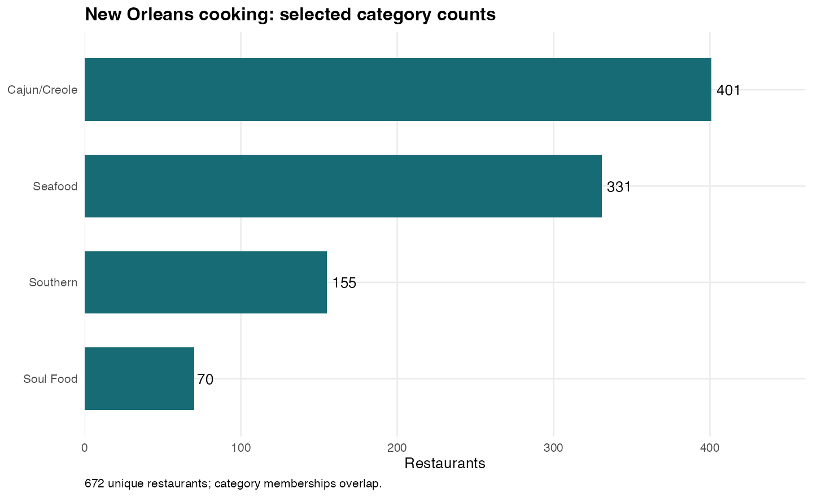
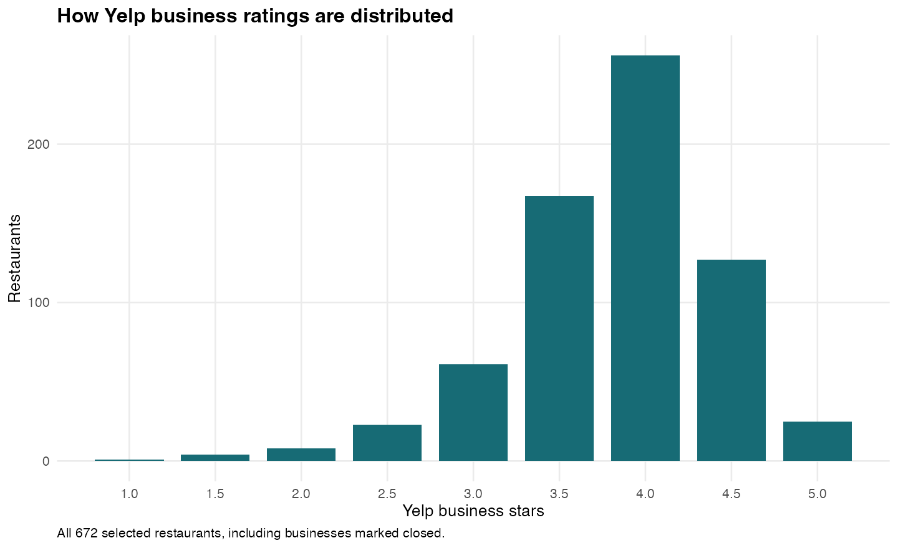
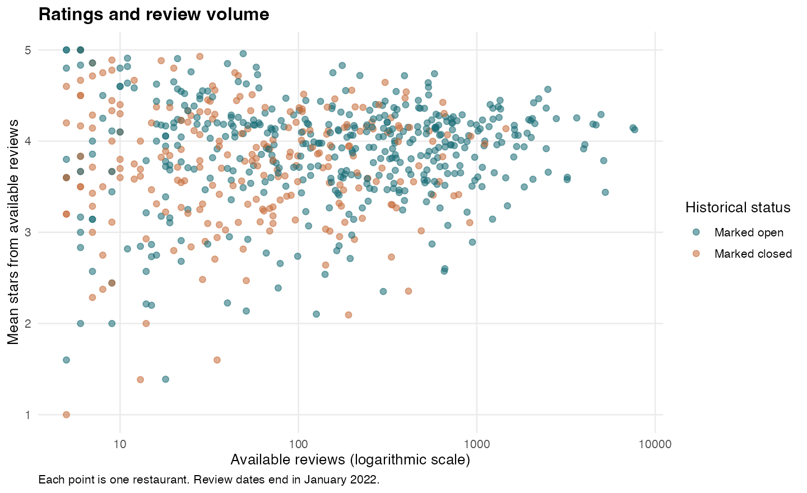

## Initial descriptive results

The filtered theme contains **672 restaurants** and **250,304 reviews** from **138,848 distinct reviewers**. Reviews span **2005-03-14 to 2022-01-19**.

### Data quality

The missing-value audit found 0 NA values and 7 blank text fields. Details are shown below.

Duplicate-ID, review-linkage, rating-range, coordinate-range, date-parsing, and open-status checks found no issues. Range checks do not establish coordinate accuracy, and absence of missing values does not establish overall accuracy.

::: {.report-table tabindex="0" role="region" aria-label="Scrollable data table"}

| Dataset | Column | NA values | Blank fields |
| --- | --- | --- | --- |
| restaurants | address | 0 | 7 |

:::

The seven blank street addresses are retained because coordinates are present. They have not been imputed or independently checked; see the exported missing-address table for follow-up.

**435 businesses are marked open and 237 marked closed** in the historical snapshot. No open-status exclusion has been applied; these flags do not verify current operating status.

### Category counts and overlap

Memberships overlap: the four category counts must not be added together. Category means describe the included businesses; they are not independent cuisine comparisons.

::: {.report-table tabindex="0" role="region" aria-label="Scrollable data table"}

| Category | Restaurants | Marked open | Mean stars | Median reviews | Total reviews |
| --- | --- | --- | --- | --- | --- |
| Cajun/Creole | 401 | 258 | 3.77 | 169.0 | 188,043 |
| Seafood | 331 | 235 | 3.87 | 117.0 | 144,026 |
| Southern | 155 | 98 | 3.91 | 174.0 | 66,355 |
| Soul Food | 70 | 47 | 3.96 | 44.5 | 16,936 |

:::

### Ratings and review volume

::: {.report-table tabindex="0" role="region" aria-label="Scrollable data table"}

| Measure | Min | Q1 | Median | Mean | Q3 | Max |
| --- | --- | --- | --- | --- | --- | --- |
| Yelp business stars | 1 | 3.50 | 4.00 | 3.82 | 4.00 | 5 |
| Available reviews per restaurant | 5 | 28.00 | 106.50 | 372.48 | 375.75 | 7,673 |
| Mean available review stars per restaurant | 1 | 3.54 | 3.94 | 3.83 | 4.21 | 5 |

:::

Business stars are Yelp's published business-level values. Mean review stars are recalculated from the available review records; they are separate measures. Each restaurant receives equal weight in the descriptive means above.

Available-review counts differ from the business table's review_count for **473 restaurants**. Both counts are retained separately; threshold comparisons below use actual available review records. The cause of any differences has not been established.

### Review-volume sensitivity

These are alternative eligibility rules, not a selected cutoff. The marked-open column shows how an additional historical open-status filter would change the pool.

::: {.report-table tabindex="0" role="region" aria-label="Scrollable data table"}

| Min reviews | Restaurants | Marked open | Mean stars |
| --- | --- | --- | --- |
| 0 | 672 | 435 | 3.82 |
| 10 | 607 | 407 | 3.83 |
| 25 | 515 | 352 | 3.84 |
| 50 | 434 | 311 | 3.84 |
| 100 | 348 | 267 | 3.86 |

:::

### Reviewer activity before normalization

Activity counts use reviews within the selected category group. This table shows how much data remains at different reviewer thresholds; no reviewer-adjusted scores have been calculated yet.

::: {.report-table tabindex="0" role="region" aria-label="Scrollable data table"}

| Min reviews per reviewer | Reviewers | Reviews retained | Reviews retained (%) |
| --- | --- | --- | --- |
| 1 | 138,848 | 250,304 | 100.00 |
| 3 | 21,971 | 109,647 | 43.81 |
| 5 | 7,123 | 60,254 | 24.07 |
| 10 | 1,395 | 25,527 | 10.20 |

:::

### What remains

This initial section preserves the original 672-restaurant subset. The steps 3–6 section below completes the city-boundary and ZCTA/ward comparisons using the resulting 656 city-contained restaurants. Final eligibility rules, reviewer-adjusted scores, and the top 15 remain outstanding; the plots above are descriptive rather than final rankings.
