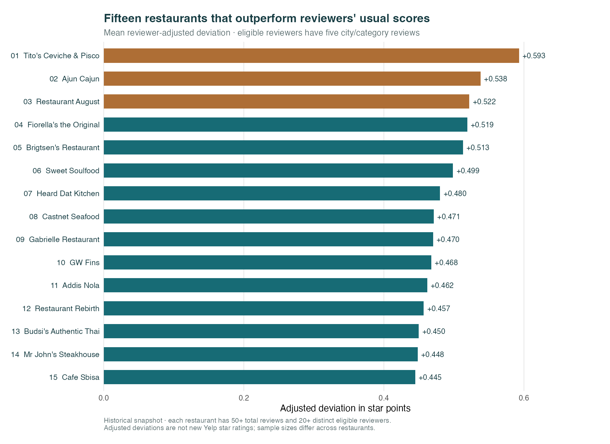

A visual research story · Historical Yelp data through January 2022

The strongest individual restaurants are spread across <strong>11 wards</strong>. Choosing one “best area” depends on how we define enough evidence.
<a class="story-button" href="#from-656-restaurants-to-15-standouts">Follow the evidence ↓</a><a class="story-text-link" href="results.html">Read the full results →</a>

<strong>The question:</strong> Where can someone find the top 15 New Orleans cooking restaurants, and which geographic area is best for finding them?

## From 656 restaurants to 15 standouts

01 / Build a comparable pool

We start with **249,002 reviews** for city-contained restaurants carrying Cajun/Creole, Seafood, Southern, or Soul Food labels. Each step makes the final shortlist more specific.

<strong>656</strong>Inside the city
All restaurants matching at least one theme label.

<strong>423</strong>Marked open
Historical snapshot flag; current operation is unverified.

<strong>288</strong>Enough review evidence
At least 50 reviews and 20 distinct eligible reviewers.

<strong>15</strong>The final shortlist
Highest mean reviewer-adjusted scores in the eligible pool.

Why these filters?

The official city-boundary check removed 16 outside-city locations from the initial 672-restaurant theme pool, preserving them in an audit. The final evidence rules balance coverage with reviewer support. The theme is label-based and includes international restaurants carrying a Seafood or other selected label. <a href="methods.html">Inspect the category and geographic checks →</a>

## A four-star review needs context

02 / Account for scoring habits

Some reviewers award high ratings frequently. Others score more strictly. We compare each review with that reviewer's usual score in this city/category pool.

Reviewer A usually gives 3 stars
4 − 3 <b>= +1.0</b>

A four-star review is above their usual score.

Reviewer B usually gives 4.5 stars
4 − 4.5 <b>= −0.5</b>

The same four-star review is below their usual score.

Illustrative examples. Adjusted scores measure deviations in star points, not new Yelp ratings. Reviewer eligibility requires five reviews in the selected city/category pool; only 23.9% of all reviews enter the adjusted analysis.

<strong>12 of 15</strong>
restaurants appear in both the raw and adjusted top 15, using the same eligible pool. Reviewer selection and adjustment still change important positions.

## The top 15

03 / Meet the standouts

**Tito's Ceviche & Pisco, Ajun Cajun, and Restaurant August** lead under the primary rules. Their review evidence differs substantially, so a rank is best read alongside its sample size.

<a class="standout-card" href="results.html#the-top-15">01<h3>Tito&#x27;s Ceviche &amp; Pisco</h3>
Ward 13 · 5015 Magazine St
<strong>+0.593</strong> adjusted star points
87 eligible reviewers · 221 total reviews
</a><a class="standout-card" href="results.html#the-top-15">02<h3>Ajun Cajun</h3>
Ward 17 · 8433 Oak St
<strong>+0.538</strong> adjusted star points
21 eligible reviewers · 51 total reviews
</a><a class="standout-card" href="results.html#the-top-15">03<h3>Restaurant August</h3>
Ward 3 · 301 Tchoupitoulas St
<strong>+0.522</strong> adjusted star points
383 eligible reviewers · 1,350 total reviews
</a>

<a class="story-button" href="results.html#the-top-15">See all 15 addresses and review counts →</a>

Seafood is one of the inclusion labels, so the shortlist includes Peruvian and Thai restaurants. This is a Yelp category grouping, not a test of culinary authenticity. The full report compares reviewer thresholds, review-volume cutoffs, and mean versus median baselines.

## Put the shortlist on the map

04 / Connect quality with place

The top 15 cross **11 wards**. A single area cannot capture every standout. Map numbers match the ranking above and the full results table.

<strong>17</strong>populated wards

<strong>17</strong>populated ZCTAs

Both systems meet the geographic-coverage requirement. Wards have more balanced restaurant counts and are the main comparison; ZCTAs remain a sensitivity view.

What do the boundaries leave out?

Two lakefront points fall roughly 13–16 metres outside the nearest ward polygon. They are retained in the city dataset and left unsnapped. Neither enters the top 15. The ward geometry is a 2026 service snapshot with no verified historical effective date. <a href="methods.html#steps-36-categories-joins-and-geography">Explore the full maps and location audit →</a>

## The area winner changes with the rules

05 / Keep the uncertainty visible

**Ward 9 leads the primary comparison:** its 12 eligible restaurants average **+0.083** star points above their reviewers' usual ratings. That answer requires at least ten eligible restaurants per ward, equal restaurant weights, and the primary reviewer/evidence rules.

The tiles below show the leading ward each time we change one analysis choice.

Primary rules<strong>Ward 9</strong><small>Primary recommendation</small>

Reviewer activity ≥3<strong>Ward 7</strong><small>Leading ward under this rule</small>

Reviewer activity ≥10<strong>Ward 12</strong><small>Leading ward under this rule</small>

Total restaurant reviews ≥25<strong>Ward 2</strong><small>Leading ward under this rule</small>

Total restaurant reviews ≥100<strong>Ward 2</strong><small>Leading ward under this rule</small>

Distinct eligible reviewers ≥10<strong>Ward 9</strong><small>Leading ward under this rule</small>

Distinct eligible reviewers ≥30<strong>Ward 12</strong><small>Leading ward under this rule</small>

Median reviewer baseline<strong>Ward 9</strong><small>Leading ward under this rule</small>

At least 5 eligible places per ward<strong>Ward 13</strong><small>Leading ward under this rule</small>

At least 15 eligible places per ward<strong>Ward 2</strong><small>Leading ward under this rule</small>

Each tile is one specification, not a probability estimate or independent vote. These are descriptive comparisons without significance tests. Ward 13's nine eligible restaurants score higher under the primary measure, but fall below the ten-restaurant area minimum.

Primary adjusted recommendation<h3>Start with Ward 9</h3>
It leads among the ten wards meeting the primary evidence rule. Wards 2, 7, 12, and 13 lead other specifications, so no single ward is a stable winner.

Largest overall selection<h3>Explore Ward 4</h3>
Its 116 theme restaurants offer the widest selection in the full city-contained pool. Selection size and adjusted quality answer different parts of the research question.

## Explore the evidence

This visual story summarizes a completed historical analysis. Reviews end in **January 2022**, and snapshot-open flags do not verify current operation. Price, travel time, accessibility, and changes over time were not modeled.

<a href="results.html"><strong>Full results</strong>Ranked table, score definitions, and sensitivity comparisons →</a><a href="methods.html"><strong>Methods & maps</strong>Categories, joins, data quality, and official boundaries →</a><a href="ai-log.html"><strong>AI assistance log</strong>Prompts, revisions, decisions, and verification →</a>

Brandon Lee · New Orleans restaurant research · Data through January 2022 · Analysis completed October 29, 2026

